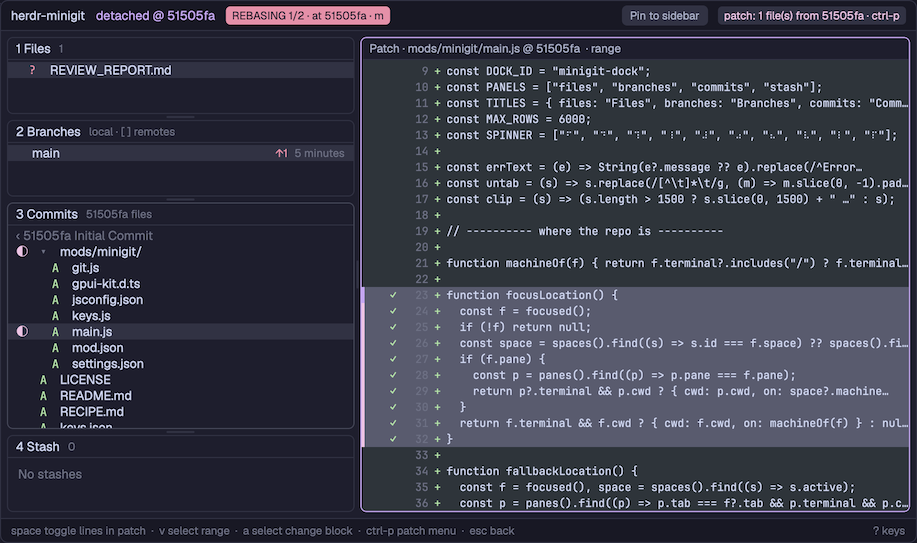

# minigit

A keyboard-first git panel for the [Herdr](https://herdr.dev) app.
Heavily inspired by the fantastic [Lazygit](https://github.com/jesseduffield/lazygit) by [Jesse Duffield](https://github.com/jesseduffield).
It follows the repo of your focused terminal, local or remote.
It lets you stage lines, resolve conflicts line by line, plan interactive rebases and move hunks between commits.

## Install

Ask your agent in Herdr: *"add the herdr mod at github.com/foehnx/herdr-minigit"*.

Or do it by hand:

1. Copy `mods/minigit/` to `~/.config/herdr-app/mods/minigit/`.
2. Merge `keys.json` into `~/.config/herdr-app/keys.json`: `ctrl-b g` opens
   minigit and `ctrl-b shift-g` toggles the sidebar dock.
3. Run `herdr-app check ~/.config/herdr-app/mods/minigit`.

You can also open it from the command palette: *minigit: open beside* or
*minigit: open in a tab*. Press `?` inside minigit for every key.

**Optional sidebar dock:** add the `minigit-dock` block from
[RECIPE.md](RECIPE.md#built-from) to a layout of your own. The window then
shows a *Pin to sidebar* button.

**Optional settings:** edit `mods/minigit/settings.json` to change
`list_row_height` (default 16) and `preview_line_height` (default 1.4).

## What it runs

minigit is trusted code. It runs `git`, `env` and `sh` on the machine where
the repo lives, and it changes your repositories when you ask it to. It
reaches the network only through git's own fetch, pull and push.

See [RECIPE.md](RECIPE.md) for the full brief.
