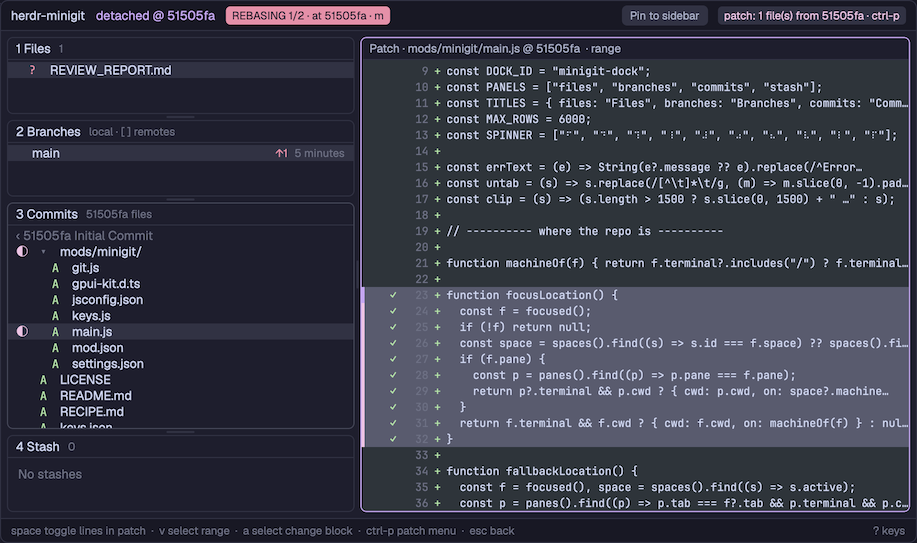

# minigit

A keyboard-first git panel for Herdr in the style of lazygit, drawn natively
rather than run in a terminal. It follows the repository of the terminal you
last focused, including terminals on other machines. It shows Files, Branches,
Commits and Stash lists beside a diff view. You can stage single lines, resolve
conflicts line by line, plan an interactive rebase, and move part of a commit
into another commit. Open it as a window, a pane or a tab, or pin it to a
sidebar.



## What you see

Everything uses `theme()` colors, so the panel follows the person's theme in
light and dark. UI text is 12.5px. Lists and diffs use the terminal font
(`settings().font_family`, falling back to Herdr's default monospace font). The
diff text size is the terminal font size minus 1, clamped to 10–16px.

- **Header** (30px, `chrome` background, bottom border):
  - repo folder name in semibold
  - `on <machine>` (dim) when the repo is on another machine
  - the branch in `accent`, or `detached @ <sha7>`, then the upstream (dim,
    11px), `↑n` in ansi2 and `↓n` in ansi1
  - while browsing another branch: a `browsing <ref> · esc` pill
  - during a rebase, merge, cherry-pick or revert: a `blocked`-colored pill
    such as `REBASING 2/5 · at abc1234 · m`
  - right-aligned: a `Pin to sidebar` / `Unpin` button, a purple (ansi5)
    `patch: n file(s) from <sha> · ctrl-p` pill while a custom patch exists,
    and a braille spinner with the running action (`Pushing`, `Fetching`, …)
- **Body** (6px padding). At 720px wide or more it is a row: the list column
  on the left (38% of the width, clamped to 260–520px) and the main view on
  the right. Narrower than 720px, the lists sit on top and the main view
  below. Splitters are 6px with a 2×28px grip and are dragged to resize.
  Double-clicking a splitter resets it. Sizes are saved separately for the
  window, the pane and the dock (`localStorage`).
  - **List column.** Four boxes with splitters between them: `1 Files`,
    `2 Branches`, `3 Commits`, `4 Stash`. Each is a rounded (6px) `surface`
    box with a 22px title row (number, name, and dim extra text such as a
    count, `local · [ ] remotes`, or `n conflicted · enter to resolve`). The
    focused box has an `accent` border and title and gets three times the
    height of the others until the person drags the splitters. List rows
    are 16px by default (configurable). The selected row is `selected` when
    its box is focused, `hover` otherwise.
    - Files: a folder tree indented 12px per level, collapsible (`▸`/`▾`).
      Two status columns: index in ansi2, worktree in ansi1, `?` for
      untracked. Name colors: ansi1 conflicted, ansi2 fully staged, `blocked`
      partially staged, `foreground` unstaged.
    - Branches: `*` on HEAD. Local branches show their tracking state on the
      right (`✓` ansi2, `↑n↓n` blocked, `gone` ansi1) and a relative date.
      `[`/`]` switches to remotes (newest 500).
    - Commits: short sha (ansi1 not pushed; ansi2 pushed and in the base branch, i.e. merged; ansi3 pushed but not merged. Base: `<remote>/HEAD`, else `<remote>/main|master`, else local `main|master`; "pushed" = on the upstream, or on any remote branch when there is none), refs in `accent`
      (at most 160px), subject, and author initials. 300 commits load first.
      `enter` replaces the list with a collapsible folder tree of that commit's
      files (`‹ sha subject` back row, indented 12px per level with `▸`/`▾`,
      status letter A ansi2 / D ansi1 / other blocked, and `●`/`◐` patch marks). During a
      rebase plan (or a live rebase in progress), the list shows the planned
      todo items above HEAD with action words colored (drop ansi1 and struck
      through, edit blocked, reword ansi4, squash/fixup ansi5, exec ansi6,
      break ansi3). During a live rebase, editing actions, reordering, or
      adding `break`/`exec` markers writes directly to `git-rebase-todo`.
    - Stash: index, subject, relative date.
  - **Main view.** A rounded `background` box with a 22px `surface` title row
    and a virtual list of diff rows. Each row has a 3px left gutter (`accent`
    at the line cursor, ansi5 on lines in the custom patch), old and new line
    numbers, and a `+`/`-` sign. Added lines get a 0x1c-alpha ansi2 wash and
    removed lines an ansi1 wash. Hunk headers are ansi6. File headers are
    `accent` and semibold. Selected lines use `selection`. In conflict mode,
    "ours" lines are ansi4-washed with `‹` and "theirs" ansi5-washed with `›`,
    and the title says which side is which during a rebase. The border turns
    `accent` while a line mode (stage / patch / conflict) has the keyboard.
- **Footer** (24px, `chrome`, 11px). It shows the key hints for the current
  context, or a transient message colored by level (error ansi1, warning
  `blocked`, success ansi2), and `? keys` on the right.
- **Modals** (prompt, confirm, menu, multi-line commit message): a centered
  `popover` box with 10px corners and `shadow_lg`, 480px wide (620px for
  text) and `esc` at the top right.

## How it behaves

- **Which repo.** Every 400ms minigit follows the cwd of the focused terminal
  (pane or layout terminal block). When none is focused, it uses a terminal in
  the shown tab or the space's folder. On another machine, git runs there
  (`exec(..., { on })`). With `props.folder` (and `props.machine`) it stays on
  that repo. It shows `Not a git repository: <cwd>` until it finds one.
- **Refreshing.** Locally, `watchFolder(root)` marks the repo dirty and it
  reloads when the window is visible. It also polls every 10s locally and
  every 4s for remote repos, but only while the window is active. It pauses
  while the app window is hidden.
- **Keys.** The full table is in `keys.js` and in the `?` help. Highlights:
  - Global: `j/k` move, `h/l/tab` switch boxes, `1–4` go to a box, `J/K`
    scroll the diff, `f` fetch --all --prune, `p` pull, `P` push (sets the
    upstream on the first push; a rejected push offers force-with-lease),
    `m` continue / skip / abort a rebase or merge, `R` refresh, `q` close
    (docked: give the keyboard back with `pane.go left`).
  - Files: `space` stage or unstage a file or folder, `enter` stage lines,
    `a` stage all, `c` commit (offers to stage all when nothing is staged),
    `C` commit in `$GIT_EDITOR`, `A` amend, `d` discard, `s`/`S` stash all or
    only staged, `e` edit in a new terminal.
  - Line staging: `space` toggles the selection, `v` selects a range, `a`
    selects a change block, `tab` switches between unstaged and staged, `d`
    discards lines.
  - Conflicts: `o`/`t`/`b`/`B` keep ours, theirs or both, `space` + `enter`
    keep picked lines, `O`/`T` resolve the whole file, `z` undo.
  - Branches: check out, new, rename, delete local or remote, set upstream,
    `enter` browses a branch's commits.
  - Commits: reword, drop, edit, squash/fixup into below, amend staged into
    the commit, change author, `ctrl-j/k` move, `i` interactive rebase plan,
    `o` copy hash, new branch here, detached checkout.
  - Custom patch: open a commit, toggle files or lines into the patch, then
    `ctrl-p` to remove it from the commit, move it into a new commit
    before or after, move it into the index, a stash, or the selected commit.
- **Editors** (`e`, `C`, `R`) open a terminal running `git var GIT_EDITOR`.
  It opens below the focused pane, or in a new tab when no pane is focused.
- **No hangs.** Every write runs with `GIT_EDITOR=true`,
  `GIT_TERMINAL_PROMPT=0` and `GIT_MERGE_AUTOEDIT=no`. Reads use
  `--no-optional-locks` and leave the index alone.
- **Pin to sidebar.** The button appears in the window form only when the
  shown layout has a block with id `minigit-dock`. It shows that block and
  closes the window. The docked copy's button says `Unpin` and hides the
  block. While a minigit window is open (`shared("minigit.window")`), the
  docked copy ignores channel keys.
- **Agent statuses.** minigit does not show agents. It never reads
  working, blocked, done or idle.

## Built from

- `mods/minigit/mod.json`: `place: "none"`, `focusable: true`, a window
  overlay of 0.92×0.88 of the window, and two palette entries
  (`pane.split {direction: right, mod: minigit}` and
  `tab.new {mod: minigit, name: git}`).
- `main.js`: the view, about 1,700 lines. `git.js` runs git and parses its
  output (status v2, for-each-ref, log, stash). It also builds partial
  patches and rebase todos and writes them through `sh -c` with the text in
  an environment variable (capped at 100 KB). `keys.js` holds the key table
  used by the footer and `?`.
- `herdr` functions: `exec`, `readTextFile`, `watchFolder`, `focused`,
  `panes`, `spaces`, `layout`, `theme`, `settings`, `props`, `run`,
  `nextCommand`, `shared` / `setShared`, `closeOverlay`, `window`,
  `checking`, `appHome`.
- Commands: `terminal.open`, `pane.close`, `pane.go`, `layout.show`,
  `layout.hide`.
- Programs: `git`, `env` and `sh`, on the repo's machine.
- Props: `{folder?, machine?}` pins a repo; `{dock: true}` marks the
  sidebar copy.
- Optional `mods/minigit/settings.json`: `list_row_height` (12–40, default
  16) and `preview_line_height` (1–3, default 1.4).
- `keys.json` (merge into yours): `ctrl-b g` opens the window and
  `ctrl-b shift-g` toggles the dock.
- Optional dock: add this block to your own (cloned) layout next to the
  work area:

  ```json
  { "id": "minigit-dock", "type": "block",
    "content": { "mod": "minigit", "props": { "dock": true } },
    "size": { "px": 560 }, "min": 340, "max": 1200, "hidden": true }
  ```

## Watch out

- **Trusted code.** It runs `git`, `env` and `sh` on whichever machine the
  focused repo is on, and it changes repositories (commits, rebases,
  discards, force-with-lease after you confirm). The network is reached
  only through git's own fetch, pull and push.
- The settings path is hard-coded as `mods/minigit/settings.json`. If you
  install under another name, update the path in `main.js`.
- `ctrl-b` as a chord prefix takes Ctrl-B (readline "back one character")
  from terminal programs. Change the bindings if you use it.
- Without a `minigit-dock` block, the Pin button is hidden and
  `ctrl-b shift-g` does nothing.
- Lists rebuild on every refresh. Diffs stop at 6,000 rows and lines at
  1,500 characters. The commit log loads 300 commits first. Remote branches
  stop at the newest 500.
- Never keep a `cx`: every async path takes the `cx` its callback gets.
- Read settings only after `checking()`, or `herdr-app check` warns about
  stranded tasks.

## Done when

- `herdr-app check mods/minigit` passes with no warnings.
- In a repo terminal, `ctrl-b g` opens the window on that repo and the
  header shows its branch and ahead/behind counts.
- Editing a file in that repo updates Files within a second, without
  pressing anything.
- `enter` on a modified file, `space` on one line and `esc` leave only that
  line staged (`git diff --cached` agrees).
- `i` on a commit, `s` on the one above it and `enter` squash them, and the
  log shows one commit fewer.
- Pinning (with the dock block in the layout) closes the window and shows
  the panel in the sidebar. `Unpin` hides it again.
- Focusing a terminal on a remote machine switches the header to
  `on <machine>`, and staging works there.
